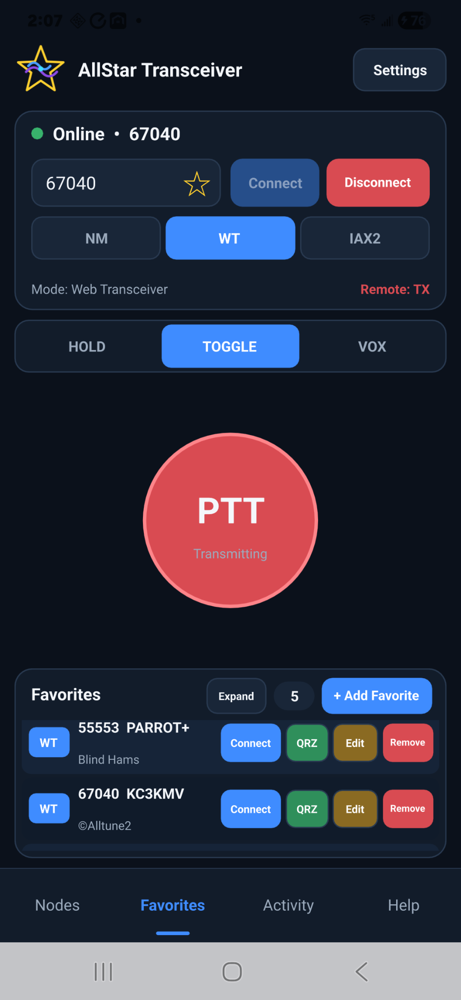

<div align="center">

# AllStar Web Transceiver (AWT)

### Native AllStarLink client for Android — v1.0

**WT Web Transceiver · Direct IAX2 / IAXRpt · Node Mode**

**Android 12+ · 64-bit ARM / arm64-v8a**

[**⬇ Download the latest Android APK**](https://github.com/TerryClaiborne/AllStarWebTransceiver-Android/releases/latest/download/AllStarWebTransceiver-Android.apk)

[View the latest release and release notes](https://github.com/TerryClaiborne/AllStarWebTransceiver-Android/releases/latest)

**Windows version:** [Microsoft Store](https://apps.microsoft.com/detail/9nk9jn5kcq1d?hl=en-US&gl=US)

</div>

---

<p align="center">
  
</p>

<p align="center"><em>AllStar Web Transceiver v1.0 — Android main operating screen</em></p>

---

## What is AllStar Web Transceiver?

**AllStar Web Transceiver (AWT)** is a native Android client for the **AllStarLink** amateur-radio network. It is designed for normal touchscreen operation on a phone and supports three separate connection methods:

- **WT — Web Transceiver**
- **IAX2 — Direct IAX2 / IAXRpt**
- **NM — Node Mode**

Each mode uses a different type of identity and credential. AWT deliberately keeps those differences visible so users know **which password belongs to which connection method**.

AWT also includes HOLD, TOGGLE and VOX transmit modes; receive and microphone gain controls; Connected Nodes / Stations; Favorites; node and callsign lookup; QRZ access; Activity information; multiple Direct IAX profiles; multiple Node Mode identities; optional protected credential storage; spoken disconnect notification; and Android background/screen-off operation while an active radio session is being maintained.

> **Important:** The Android APK is distributed through this project's official GitHub **Releases** page. It is not currently distributed through Google Play.

---

## Quick download

### Android

**Current release APK:**

[**Download AllStarWebTransceiver-Android.apk**](https://github.com/TerryClaiborne/AllStarWebTransceiver-Android/releases/latest/download/AllStarWebTransceiver-Android.apk)

**Release page:**

[Latest AWT Android Release](https://github.com/TerryClaiborne/AllStarWebTransceiver-Android/releases/latest)

After downloading, follow the detailed [Installing the APK](#installing-the-apk) instructions below. Android may ask you to allow installation from the browser or file manager that opened the APK, and Play Protect may display a sideload warning.

Before installing, verify the APK using the [SHA-256 verification](#sha-256-verification) instructions below.

---

## Current Android release

**Version:** `v1.0`  
**APK:** `AllStarWebTransceiver-Android.apk`

The v1.0 APK was real-device tested with WT, Direct IAX2, and Node Mode over both Wi-Fi and Cellular before publication.

## Three connection modes at a glance

| Mode | What AWT uses as your identity | Password / secret to use | Where it comes from |
|---|---|---|---|
| **WT** | Your AllStarLink callsign/account | **AllStarLink website/account password** | The password you use to sign in at AllStarLink |
| **IAX2** | An IAX username authorized by the destination node | **Destination-specific IAX secret** | The destination node's IAX configuration or node operator |
| **NM** | One of your owned AllStar node numbers | **That node's AllStarLink Node Password** | The node's settings in your AllStarLink account |

**These three passwords are not interchangeable.**

---

## Support / contact

**By KC3KMV**

For support or contact:

**[KC3KMV on QRZ](https://www.qrz.com/db/KC3KMV)**

When reporting a problem, never post your AllStarLink website password, Node Password, or Direct IAX secret.

---

# Contents

1. [Android requirements](#android-requirements)
2. [Before you install](#before-you-install)
3. [Installing the APK](#installing-the-apk)
4. [Updating AWT later](#updating-awt-later)
5. [First-time setup](#first-time-setup)
6. [Web Transceiver — WT](#web-transceiver--wt)
7. [Direct IAX2 / IAXRpt — IAX2](#direct-iax2--iaxrpt--iax2)
8. [Node Mode — NM](#node-mode--nm)
9. [Main operating screen](#main-operating-screen)
10. [PTT operation](#ptt-operation)
11. [Audio controls](#audio-controls)
12. [VOX controls](#vox-controls)
13. [Connected Nodes / Stations](#connected-nodes--stations)
14. [Favorites](#favorites)
15. [Node Lookup and Callsign Lookup](#node-lookup-and-callsign-lookup)
16. [Activity](#activity)
17. [Remember Credentials and password security](#remember-credentials-and-password-security)
18. [Spoken disconnect alert](#spoken-disconnect-alert)
19. [Background and screen-off operation](#background-and-screen-off-operation)
20. [Wi-Fi and cellular operation](#wi-fi-and-cellular-operation)
21. [Connection-loss and transmit safety](#connection-loss-and-transmit-safety)
22. [Troubleshooting](#troubleshooting)
23. [APK authenticity](#apk-authenticity)
24. [SHA-256 verification](#sha-256-verification)
25. [Privacy and local data](#privacy-and-local-data)
26. [Reporting a problem](#reporting-a-problem)

---

# Android requirements

The AWT Android release is intended for:

- **Android 12 or newer**
- **64-bit ARM / arm64-v8a**
- an Internet connection that permits the required AllStar/IAX UDP traffic;
- microphone permission for transmit audio.

AWT has been real-device tested on a Samsung Galaxy S22+ running Android 16.

A phone being able to browse the web does not automatically guarantee that every Wi-Fi or cellular network will pass the UDP/IAX traffic used by every AWT mode. Some managed, public, corporate, hotel, school, or carrier networks can restrict UDP traffic.

---

# Before you install

The Android release is distributed as an APK through the official GitHub **Releases** section.

Because this APK is installed outside Google Play, Android may display additional security prompts.

Before installing:

1. Make sure the APK came from the official AllStar Web Transceiver GitHub Release.
2. Compare the APK's SHA-256 with the SHA-256 published with that Release.
3. Do not install an AWT APK sent to you privately by an unknown person or downloaded from an unrelated site.
4. Never share your AllStarLink website password, Node Password, or IAX secret when asking for installation help.

---

# Installing the APK

## 1. Download the APK

Open the official AWT GitHub repository on the Android device.

Open **Releases**, choose the current Android release, and download the `.apk` file.

## 2. Open the downloaded APK

Depending on the phone and browser, the APK may appear in:

- the browser's Downloads list;
- Android's Downloads application;
- a file manager;
- the notification shade after the download completes.

Tap the APK to begin installation.

## 3. Allow installation from that source if Android asks

Android may display a message similar to:

> For your security, your phone currently isn't allowed to install unknown apps from this source.

This does **not** mean AWT needs a system-wide security setting disabled.

Android normally grants this permission to the specific application that is opening the APK, such as the browser or file manager.

Follow the Android prompt to allow **Install unknown apps** for that source, then return to the APK installation.

The exact wording varies between Android versions and phone manufacturers.

## 4. Play Protect or other Android security warning

Because the GitHub APK is not being installed through Google Play, Android or Google Play Protect may display a warning.

Do not automatically ignore the warning.

First verify:

- you downloaded the APK from the official AWT GitHub Release;
- its SHA-256 matches the value published with that Release.

If your device then offers **More details**, **Install anyway**, or similar wording, you can decide whether to continue.

Do **not** globally disable Android security or Play Protect just to install AWT.

## 5. Finish installation

When Android reports that installation is complete, open:

**AllStar Web Transceiver**

from the installation screen or from the app drawer.

---

# Updating AWT later

If a future AWT Android release is published, the normal update procedure will be:

1. download the newer APK from the official GitHub Release;
2. verify its SHA-256;
3. install it over the existing AWT installation.

Do **not** uninstall the existing public release first unless you intentionally want to erase its application data.

Normal upgrades signed with the same permanent AWT release key are intended to preserve:

- Settings;
- saved Direct IAX profiles;
- saved Node Mode identities;
- Favorites;
- audio settings;
- VOX settings;
- remembered credentials.

---

# First-time setup

Open AWT and tap **Settings** before the first connection.

At minimum:

1. enter your callsign;
2. configure the credentials for the connection mode you plan to use;
3. choose whether credentials should be remembered on the phone;
4. check Receive Volume;
5. check Microphone Gain;
6. review VOX settings if you plan to use VOX;
7. decide whether the spoken disconnect alert should be enabled;
8. tap **Save**.

If you use more than one mode, configure each mode separately.

## Settings Save / Cancel behavior

- **Save** validates the entered values and stores the settings.
- Password/secret confirmation fields must match before Save succeeds, whether Remember Credentials is ON or OFF.
- **Cancel** or Android Back leaves Settings without saving unsaved changes.
- A radio connection error from the main screen is not treated as a Settings validation error merely because Settings is opened afterward.

---

# Web Transceiver — WT

## What WT is

WT uses your normal AllStarLink account to obtain Web Transceiver authorization and connect to a destination node.

For many users this will be the simplest mode because it does not require the destination operator to create a private IAX login for you and it does not require you to register as one of your own nodes.

## WT credentials

WT requires:

- **Callsign**
- **AllStarLink website/account password**
- **Re-enter website/account password**

Use the same password you use to log into the AllStarLink website.

## Configure WT

1. Open **Settings**.
2. Find **Web Transceiver Account**.
3. Enter your callsign.
4. Enter your AllStarLink website/account password.
5. Enter the same password again in the confirmation field.
6. Choose whether **Remember credentials** should be enabled.
7. Tap **Save**.

The two password entries must match when Settings is saved whether Remember Credentials is ON or OFF.

Remember Credentials controls storage. It does not disable password confirmation.

## Connect with WT

1. Return to the main screen.
2. Select **WT**.
3. Enter the remote **Destination Node**.
4. Tap **Connect**.

AWT performs the required AllStarLink authorization and destination lookup.

## What WT does not require

WT does not require:

- a saved Direct IAX profile;
- an IAX username;
- an IAX secret;
- a Node Mode Register-As identity;
- an AllStar Node Password.

---

# Direct IAX2 / IAXRpt — IAX2

## What Direct IAX2 is

Direct IAX2 connects AWT directly to a destination node's Asterisk/IAX service.

This mode is mainly useful when:

- you operate the destination node;
- the destination node operator has created an IAX login for you;
- you specifically want to use a direct IAX path instead of WT.

Most ordinary users may never need Direct IAX2. It is included because it is useful to node operators and advanced users.

## A Direct IAX login belongs to one destination

AWT intentionally binds a saved Direct IAX login to its destination node.

For example:

`12345 — iaxrpt`

means:

> Use this saved `iaxrpt` login when connecting directly to node `12345`.

Another node may also use the username `iaxrpt` but have a completely different secret.

Do not treat one saved IAX secret as a universal AllStar password.

## Multiple Direct IAX profiles

AWT can store more than one Direct IAX login.

This is useful if you have direct access to several nodes with different:

- node numbers;
- usernames;
- secrets;
- ports;
- hostnames;
- contexts;
- extensions.

## Add a Direct IAX login

1. Open **Settings**.
2. Open the **Direct IAX2 / IAXRpt** section.
3. Choose **Add Direct IAX Login**.
4. Enter the fields described below.
5. Save the Direct IAX entry.
6. Save Settings when finished.

## Direct IAX fields

### Destination AllStar Node

This is the AllStar node that this username/secret belongs to.

Example:

`12345`

Do not put an unrelated node number here.

### IAX Username

The IAX username configured on the destination node.

A common example is:

`iaxrpt`

but use the username the destination operator actually gave you.

### IAX Secret

The password/secret configured for that IAX username on that destination node.

This is **not** your AllStarLink website password.

This is **not** your AllStar Node Password.

### Re-enter IAX Secret

Enter the same IAX secret again.

The two values must match when the Direct IAX entry is saved whether Remember Credentials is ON or OFF.

### Use automatic AllStarLink IAX host/port lookup

Normally leave this **ON**.

This is the recommended setting.

AWT looks up the destination node's advertised IAX hostname and UDP port through AllStarLink.

This matters because not every AllStar node uses the same IAX port.

Do not assume UDP `4569` merely because it is common.

### Manual IAX Destination Override

This section is used when automatic host/port lookup is turned **OFF**.

Use it only when you deliberately need to override the normal AllStarLink lookup.

#### Host

Enter the exact hostname or IP address supplied by the destination operator.

#### UDP Port

Enter the exact IAX UDP port used by the destination.

### Called Context — optional

This is an advanced IAX setting.

Normally leave it blank.

Only enter a context when the destination node's IAX configuration specifically requires one.

### Called Extension

The called extension sent during Direct IAX call setup.

AWT supports:

`%NODE%`

as a placeholder meaning:

> use the Destination AllStar Node number.

For a normal configuration, keep the value recommended by the destination operator.

## Direct IAX Reset Defaults

The Direct IAX editor provides **Reset Defaults**.

It restores the normal technical defaults:

- Username: `iaxrpt`
- Automatic AllStarLink lookup: **ON**
- Host: `%NODE%.nodes.allstarlink.org`
- UDP Port: `4569`
- Called Context: blank
- Called Extension: `%NODE%`

Reset Defaults intentionally does **not** erase:

- Destination AllStar Node
- IAX Secret

Those two values are user-specific and are not technical defaults.

## Remove a Direct IAX login

Use **Remove** in the Direct IAX profile area to delete the selected saved login.

Removing a Direct IAX login does not delete Favorites automatically. A Favorite that depended on the removed login may need to be edited before it can connect again.

## Connect with Direct IAX2

1. Select **IAX2** on the main screen.
2. Select the saved Direct IAX login for the desired node.
3. Verify the Destination Node.
4. Tap **Connect**.

If automatic lookup is enabled, AWT resolves the current advertised endpoint before call setup.

---

# Node Mode — NM

## What Node Mode is

Node Mode allows AWT to operate using an **AllStar node identity that you own**.

This is different from WT and different from Direct IAX2.

In Node Mode there are two node numbers that must not be confused:

- **Register As** — who AWT is operating as;
- **Destination Node** — who you want to connect to.

## Node Mode credentials

Node Mode requires:

- an AllStar node number that belongs to you;
- that node's **AllStarLink Node Password**.

The Node Password is obtained from the settings for that owned node in your AllStarLink account.

## Register As

**Register As** is one of your owned AllStar nodes.

Example:

`12345`

AWT uses that node identity for Node Mode registration and call operation.

The physical radio/node normally associated with that identity does **not** have to be online while AWT is operating in Node Mode.

For the least confusing operation, do not intentionally have multiple independent applications or devices competing to register the same node identity at the same time.

## Destination Node

The **Destination Node** is the remote node you want to connect to.

Example:

- Register As: `12345`
- Destination Node: `55553`

AWT operates as node `12345` and connects to remote node `55553`.

The Destination Node must be different from the Register-As identity.

AWT blocks a Node Mode connection when the Destination is the same as Register As.

## Add a Node Mode identity

1. Open **Settings**.
2. Open **Node Mode**.
3. Choose **Add Node**.
4. Enter an owned AllStar node number.
5. Enter that node's AllStarLink Node Password.
6. Enter the same Node Password again.
7. Save the entry.
8. Save Settings.

The two Node Password entries must match whether Remember Credentials is ON or OFF.

## Multiple Node Mode identities

If you own more than one AllStar node, each can be saved separately.

You can then choose which owned identity AWT should use for a Node Mode connection or Favorite.

## Remove a Node Mode identity

Use **Remove** to delete the selected saved owned-node identity.

Removing the identity does not automatically delete Favorites that referred to it. Edit those Favorites if necessary.

## Connect with Node Mode

1. Select **NM**.
2. Choose the desired **Register As** owned node.
3. Enter the remote **Destination Node**.
4. Tap **Connect**.

AWT handles Node Mode registration and the required IAX signaling automatically.

There is no user setting for the internal Node Mode heartbeat/registration maintenance.

---

# Main operating screen

## Mode selector

The Android mode selector is displayed:

`NM | WT | IAX2`

The current color mapping is:

- **NM** — green
- **WT** — blue
- **IAX2** — brown

WT is centered.

## Destination Node

Enter the numeric AllStar node you want to reach.

The meaning is the remote destination in all three modes.

In Node Mode, Destination is **not** the Register-As identity.

## Saved IAX login

When IAX2 is selected, choose the saved Direct IAX login associated with that destination.

## Register As

When NM is selected, choose the owned AllStar node identity AWT should use.

## Connect

Starts the selected radio session.

AWT uses:

- the selected mode;
- Destination Node;
- saved Direct IAX login when applicable;
- selected Register-As node when applicable;
- stored credentials for that mode.

## Disconnect

Ends the active radio session.

Disconnect also forces the local transmit state off.

## Connection status

AWT shows the current session state, including states such as:

- offline;
- connecting;
- connected;
- transmitting;
- disconnected/lost;
- error.

A connection/setup error appears in the operating context where the failure occurred.

## Remote TX indicator

Android displays remote radio state such as:

- **Remote: idle**
- **Remote: TX**

The TX indication is also active while AWT itself is locally keyed.

## Bottom navigation

The Android navigation is:

`Nodes | Favorites | Activity | Help`

Each button opens its associated view.

---

# PTT operation

AWT provides three PTT styles.

## HOLD

Use HOLD like a conventional microphone PTT.

- press and hold the large PTT control to transmit;
- release it to unkey.

The PTT control changes appearance while the transmitter is actually keyed.

Pressing the PTT while offline does not create a fake keyed state.

## TOGGLE

Use TOGGLE when you do not want to hold the PTT control continuously.

- first tap = key;
- second tap = unkey.

Always verify that the keyed indication is off when you are finished transmitting.

## VOX

VOX automatically keys when microphone audio stays above the configured threshold for the configured Attack time.

When microphone level falls below threshold, Hang time controls how long AWT remains keyed.

Maximum Transmit is a safety timer that prevents VOX from remaining keyed indefinitely.

## Manual PTT while VOX is active

AWT intentionally handles a manual PTT action during VOX this way:

1. force unkey;
2. leave VOX;
3. switch to TOGGLE;
4. remain unkeyed;
5. the next PTT tap performs a normal Toggle key.

Exiting VOX does not immediately key the transmitter.

## VOX on a phone

Phone speaker audio can be heard by the phone's own microphone.

That can cause VOX to retrigger on:

- received speech;
- repeater courtesy tones;
- return tones;
- loud speaker audio.

For best VOX results, use a Bluetooth headset, wired headset, or another arrangement that keeps received audio out of the microphone.

---

# Audio controls

## Receive Volume

Controls software gain applied to incoming radio audio.

Android slider:

- Range: `0%` to `200%`
- Step: `5%`
- Normal/default: `100%`

`100%` is the normal unity setting.

Raise it if receive audio is too quiet.

Lower it if receive audio is too loud or distorted.

Receive Volume does not change your transmitted microphone level.

## Microphone Gain

Controls gain applied to microphone audio sent to the radio session.

Android slider:

- Range: `0%` to `200%`
- Step: `5%`
- Normal/default: `100%`

Raise it if transmitted audio is too quiet.

Lower it if transmitted audio is too loud or distorted.

## Mic Level

The live microphone-level display shows microphone activity.

It is a meter, not a gain control.

Use Mic Level to confirm that the phone microphone is hearing you, then use Microphone Gain to adjust transmitted level.

## Audio Reset Defaults

The Audio section provides **Reset Defaults**.

It restores:

- Receive Volume: `100%`
- Microphone Gain: `100%`

It does not change:

- connection credentials;
- Favorites;
- Direct IAX profiles;
- Node Mode identities;
- VOX timing.

---

# VOX controls

These values control automatic transmit operation when **VOX** is selected.

## Threshold / Sensitivity

- Range: `1%–100%`
- Step: `1%`
- Default: `8%`
- Lower value = more sensitive.
- Higher value = less sensitive.

Raise Threshold if room/background noise keys the transmitter. Lower it carefully if normal speech does not key reliably.

## Attack

- Range: `0–5000 ms`
- Step: `10 ms`
- Default: `120 ms`

Attack is how long audio must stay above Threshold before VOX keys. Too short can let brief noises key the radio; too long can clip the beginning of speech.

## Hang

- Range: `0–10000 ms`
- Step: `50 ms`
- Default: `700 ms`

Hang is how long AWT remains keyed after microphone audio falls below Threshold. Too short can cause rapid unkeying between words; too long keeps the transmitter keyed unnecessarily.

## Maximum Transmit

- Range: `1–600 seconds`
- Step: `5 seconds`
- Default: `180 seconds`

This is a VOX safety timeout. If VOX remains continuously active for the configured maximum, AWT forces an unkey and waits for microphone level to fall before re-arming.

## VOX Reset Defaults

**Reset Defaults** restores:

- Threshold: `8%`
- Attack: `120 ms`
- Hang: `700 ms`
- Maximum Transmit: `180 sec`

Tap **Save** if you want the reset values persisted.

---

# Connected Nodes / Stations

The **Nodes** view shows nodes/stations reported for the active destination.

It includes a visible count.

## Compact view

The normal phone layout keeps the node list compact so the PTT and operating controls remain available.

## Expand / Close

Use **Expand** to enlarge the Connected Nodes view when you want to see more rows.

Use **Close** to return to the compact layout.

## Numeric node rows

A numeric AllStar node can be tapped to start an Add/Edit Favorite flow.

Because the Connected Nodes list does not know a private IAX secret and does not know which node identities you own, this shortcut uses **WT** as the safe default Favorite mode.

You can edit the Favorite afterward if you intentionally want another mode.

## Client / Station rows

Nonnumeric Client / Station rows are displayed for awareness.

They are not treated as AllStar node numbers and are not automatically made into node Favorites.

## When the session ends

Connected Nodes / Stations represents the active session.

The live list is cleared when the radio session is no longer active.

---

# Favorites

Favorites are one of the main everyday operating features in AWT.

A Favorite can remember:

- Destination Node;
- callsign/station;
- location;
- your own Description;
- connection mode;
- selected Direct IAX login for IAX2;
- selected Register-As identity for NM.

The same destination can be saved more than once using different modes.

Example:

- `55553` as WT
- `55553` as IAX2
- `55553` as NM

Each Favorite remembers how **that Favorite** should connect.

## Favorite mode badges

Favorites identify their saved connection type with mode labels such as:

- WT
- IAX / IAX2
- NM

## Add Favorite manually

Open **Add Favorite**.

You do not have to pre-fill the main Destination field first.

Choose the Favorite's:

- mode;
- Destination Node;
- saved Direct IAX login if IAX2;
- Register-As identity if NM;
- lookup information;
- Description.

Then save it.

## Add Favorite from Connected Nodes

While connected:

1. open **Nodes**;
2. tap a numeric node;
3. AWT opens the Favorite editor aimed at that node;
4. review the lookup information;
5. edit the Description if desired;
6. save.

This shortcut defaults to WT because a public connected-node row does not provide private IAX credentials and does not prove ownership for Node Mode.

## Connect

Tap **Connect** on a Favorite.

AWT restores:

- the saved Destination;
- the saved mode;
- the saved Direct IAX login when needed;
- the saved Node Mode identity when needed.

If Favorites is currently expanded, connecting a Favorite automatically retracts the expanded content so the PTT is immediately available.

## QRZ

Tap **QRZ** to open the saved callsign's QRZ page in the phone's external web browser.

If there is no usable callsign, AWT does not perform a bad QRZ lookup.

## Edit

Tap **Edit** to change the selected Favorite.

Depending on mode, you can change:

- Destination Node;
- callsign;
- location;
- Description;
- connection mode;
- Direct IAX login;
- Node Mode identity;
- lookup result.

The Description is user-editable.

Lookup information should not overwrite a Description you intentionally wrote.

## Remove

Tap **Remove** to begin deletion of that Favorite.

AWT shows confirmation:

`Cancel | Remove`

- **Cancel** keeps the Favorite.
- **Remove** confirms deletion.

Only the selected Favorite is deleted.

Removing a Favorite does not remove the underlying Direct IAX profile or Node Mode identity from Settings.

## Favorite action colors

The current Favorite row uses distinct action colors:

- Connect — blue
- QRZ — green
- Edit — amber/gold
- Remove — red

## Expand / Close

Favorites supports the same expanded-card behavior as Nodes.

Use **Expand** to show more Favorites.

Use **Close** to return to the compact operating layout.

---

# Node Lookup and Callsign Lookup

The Favorite editor can retrieve public AllStarLink information.

## Lookup Node

Enter a numeric AllStar node and choose **Lookup Node**.

When data is available, AWT can populate:

- callsign;
- location;
- suggested Description information.

If you change the node number, stale lookup information from the previous node is cleared so the old station information is not accidentally saved against the new node.

## Lookup Callsign

Enter a callsign and choose **Lookup Callsign**.

If one exact AllStar node matches, AWT can populate that node.

If the callsign has several nodes, AWT presents a chooser so you can select the correct node.

## Description behavior

The Description belongs to you.

Lookup is intended to help with station information, not take ownership of your Description field.

You can use Description for anything useful, such as:

- repeater name;
- club name;
- city;
- hub;
- parrot;
- operating note.

---

# Activity

The **Activity** view is useful when something does not connect or when you want to see what AWT is doing.

Activity can show operating events such as:

- connection request;
- selected mode;
- lookup progress;
- authentication progress;
- connection established;
- disconnect;
- connection loss;
- lookup errors;
- authentication errors;
- IAX setup errors;
- VOX safety events.

When a connection fails, check Activity before changing unrelated settings.

---

# Remember Credentials and password security

AWT intentionally separates the three credential types.

When Remember Credentials is enabled on Android, remembered secrets use Android secure storage backed by AndroidKeyStore and authenticated encryption.

The Android credential path uses:

- AndroidKeyStore;
- AES/GCM;
- a device-held key;
- random IVs;
- authenticated encrypted storage.

Do not publish or send anyone:

- your AllStarLink website password;
- any Node Password;
- any Direct IAX secret;
- screenshots showing credentials;
- application-data backups containing secrets.

AWT support should never require you to publicly post a password.

---

# Spoken disconnect alert

If **Speak disconnect alert** is enabled, Android speaks a local disconnect notification after an actual connected session ends.

It is tied to the radio session state, not to ordinary changes in the Connected Nodes list.

That prevents a downstream station appearing/disappearing from being mistaken for your own AWT session disconnect.

There is intentionally no added local spoken connect announcement.

---

# Background and screen-off operation

AWT is designed to keep an active radio session operating when:

- the phone screen turns off;
- another app is brought to the foreground;
- AWT is temporarily in the background.

Android may display a foreground-service notification while an active radio session is being maintained.

This is normal.

If AWT is removed/terminated, it performs cleanup that includes:

- force-unkey;
- stopping VOX transmit state;
- clearing local transmit state;
- disconnecting the radio session.

Using Android **Force Stop** terminates AWT and its background radio operation.

---

# Wi-Fi and cellular operation

AWT can operate over both Wi-Fi and cellular data.

Real-device testing has included repeated WT, NM, and Direct IAX2 operation on both network types.

However, network conditions matter.

A connection can fail if a network blocks or interferes with required UDP/IAX traffic.

## When moving between Wi-Fi and cellular

If you change networks:

1. allow Android to establish the new Internet path;
2. disconnect/reconnect AWT if necessary;
3. verify the selected mode and Destination;
4. if Direct IAX2 fails once during very rapid mode/network switching, retry before changing configuration;
5. use Activity to determine whether the failure was lookup, authentication, or call setup.

Do not immediately rewrite working credentials because of one transient network failure.

---

# Connection-loss and transmit safety

AWT is designed so a dropped network or application session does not leave the local radio logically keyed.

When the active connection is lost:

- PTT is forced off;
- VOX is disabled/unkeyed for that session;
- stale local transmit state is cleared;
- status returns to disconnected/lost;
- the active Connected Nodes list is no longer treated as a live session.

If anything looks wrong after a network loss, verify that the PTT/keyed indication is off before reconnecting.

---

# Troubleshooting

## Start with Activity

Before changing settings, read Activity.

It can often tell you whether the problem is:

- lookup;
- authorization;
- wrong credentials;
- connection setup;
- network loss.

---

## WT login fails

Check:

- Callsign is correct.
- You used your **AllStarLink website/account password**.
- You did not use a Node Password.
- You did not use an IAX secret.
- The two WT password fields match.
- Internet access is working.

---

## Direct IAX2 fails

Check:

- Destination Node is correct.
- The selected Direct IAX login belongs to that destination.
- IAX Username is correct.
- IAX Secret is correct.
- The two IAX secret fields match when editing/saving.
- Automatic AllStarLink host/port lookup is ON unless you intentionally use manual override.
- If manual override is used, Host and UDP Port are correct.
- Called Context is blank unless the node operator requires it.
- Called Extension matches the destination configuration.

Do not assume the destination uses UDP `4569`.

### One transient IAX failure after rapid mode switching

If you are rapidly connecting/disconnecting through Favorites and changing modes, an immediate retry can be appropriate before changing Settings.

If the failure becomes repeatable under normal use, capture the mode sequence and Activity message and report it.

---

## Node Mode fails

Check:

- Register As is an AllStar node that you own.
- The Node Password belongs to that Register-As node.
- You did not use your website password.
- You did not use an IAX secret.
- The two Node Password fields match.
- Destination Node is different from Register As.
- Internet/UDP connectivity is available.

If another independent application/device is simultaneously using the same Node Mode identity, stop the duplicate use before assuming AWT credentials are wrong.

---

## "Node Mode destination must be different from the Register As node"

Register As and Destination are the same number.

Choose another remote Destination Node.

Example:

- Register As `12345`
- Destination `55553`

---

## No microphone audio

Check:

- Android microphone permission is granted;
- Mic Level moves when you speak;
- Microphone Gain is not too low;
- a Bluetooth/headset microphone is actually the microphone you expect Android to be using.

---

## Transmit audio too quiet

Raise **Microphone Gain** carefully.

Watch Mic Level and obtain an on-air report if possible.

---

## Transmit audio too loud or distorted

Lower **Microphone Gain**.

Receive Volume does not fix transmitted audio.

---

## Receive audio too quiet or too loud

Adjust **Receive Volume**.

Do not use Microphone Gain to fix receive audio.

---

## VOX keys from room noise

Raise **VOX Threshold**.

Also check whether the phone speaker is feeding received audio back into the microphone.

---

## VOX misses the beginning of words

Reduce **Attack** carefully.

---

## VOX drops between words

Increase **Hang** carefully.

---

## VOX remains keyed too long

Reduce **Hang**.

Also verify Maximum Transmit is set to a reasonable safety value.

---

## VOX retriggers on courtesy tones

This can happen when the phone speaker's received audio enters the phone microphone.

Use a headset or other audio arrangement that separates speaker audio from the microphone.

---

## Favorite lookup shows information from the wrong node

Change the Destination Node and run Lookup again.

AWT is designed to clear stale lookup data when the node changes.

---

## Callsign lookup shows several nodes

Choose the correct node from the result list.

A callsign can legitimately have more than one AllStar node.

---

## QRZ opened the browser

That is intentional.

AWT uses the phone's external browser for QRZ rather than embedding a browser in the radio application.

---

## Settings shows a password mismatch

Re-enter both values exactly.

Password confirmation is required even when Remember Credentials is OFF.

Remember controls storage, not validation.

---

# APK authenticity

The official AWT Android APK is digitally signed so Android can identify official AWT releases and accept future updates signed with the same identity.

**Official AWT signing-certificate SHA-256:**

`66BE7641C9E9F5A0AE796BC25541E64BFBD43FBB4E5F23CEF4386ADF4A6DF1F0`

This value is a **public certificate fingerprint, not a password or secret**. It may be used to verify that an APK carries the official AWT signing identity.

---

# SHA-256 verification

Every public Android Release should publish the exact SHA-256 of the APK.

## Verify on Windows PowerShell

The command below must be run from the folder that actually contains the downloaded APK.

1. Download `AllStarWebTransceiver-Android.apk`.
2. Open **File Explorer** and browse to the folder where the APK was saved, usually **Downloads**.
3. Click the File Explorer address bar, type `powershell`, and press **Enter**. PowerShell will open in that exact folder.
4. Run:

```powershell
Get-FileHash .\AllStarWebTransceiver-Android.apk -Algorithm SHA256
```

PowerShell will display the APK's SHA-256. Compare the complete 64-character value with the official release hash below.

If PowerShell says the file cannot be found, you are not in the folder containing the APK. Do not change the filename; open PowerShell from the correct folder and run the command again.

> **AWT Android v1.0 APK SHA-256:** `614C621098500E4084B0928228833A91BCB3D94B3FD535E1C508C330730EA903`

---

# Privacy and local data

AWT stores application configuration locally so normal settings survive application restarts and upgrades.

Local data can include:

- selected mode;
- Direct IAX profile definitions;
- Node Mode identities;
- Favorites;
- audio settings;
- VOX settings;
- remembered credentials when enabled.

Remembered Android credentials use protected local storage.

The public release must never contain the developer/tester's:

- passwords;
- Node Passwords;
- IAX secrets;
- private Favorites;
- private configuration;
- test credentials.

When posting a screenshot or log for support, check it first for private information.

---

# Reporting a problem

For AWT support, contact **KC3KMV on QRZ**:

**https://www.qrz.com/db/KC3KMV**

If something fails, include useful operating information without including secrets.

Please report:

- Android version;
- phone model;
- AWT version;
- Wi-Fi or Cellular;
- connection mode: WT / IAX2 / NM;
- Destination Node, if you are comfortable sharing it;
- Register-As node for an NM problem, if relevant;
- whether the failure repeats;
- the exact Activity/error message;
- what you expected;
- what actually happened.

For a connection-sequence problem, describe the sequence.

Example:

`WT -> Disconnect -> NM -> Disconnect -> IAX2`

Never post:

- WT website password;
- Node Password;
- IAX secret.

---
